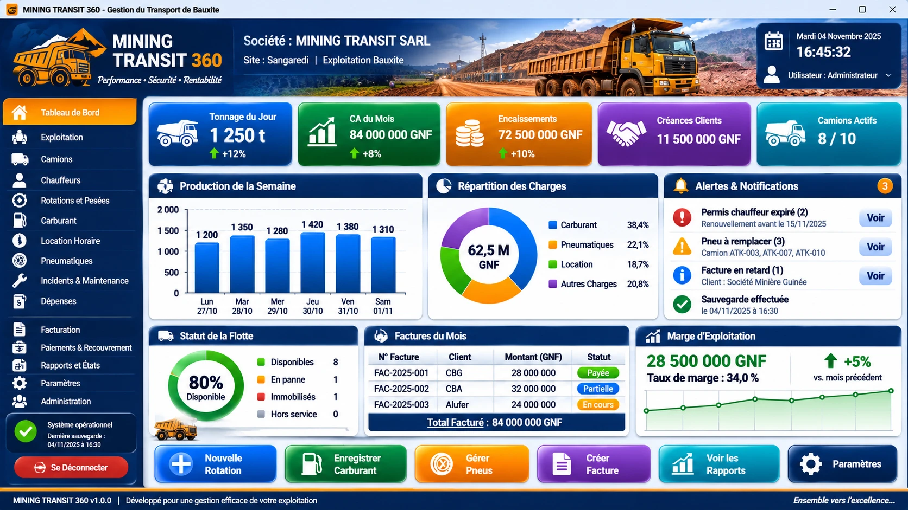

# MINING TRANSIT 360

Logiciel de gestion du transport de bauxite (site de Sangaredi, Guinée) développé **de zéro** en Microsoft Excel VBA :
exploitation, flotte Atiko en location horaire, rotations et pesées, carburant, pneumatiques, incidents et maintenance,
dépenses, facturation mensuelle au tonnage validé, encaissements et recouvrement, rapports, clôtures, sécurité, sauvegardes.



## Contenu

| Dossier | Contenu |
|---|---|
| `src/vba/modules` | 34 modules standard (.bas) : noyau, données, métier, interface, états, système, recette |
| `src/vba/classes` | `cFieldDef`, `cCtlEvents`, `cReport` |
| `src/vba/forms` | `frmLogin`, `frmList`, `frmRecord`, `frmInput`, `frmReports` (contrôles créés à l'exécution) |
| `src/vba/document` | code de `ThisWorkbook` |
| `tools` | schéma (source unique), générateurs de données / classeur / icônes / documentation, analyseur statique VBA |
| `build` | `Build-MT360.cmd` / `.ps1` : assemble, **compile**, installe et **teste** `MINING_TRANSIT_360.xlsm` dans Excel |
| `dist` | `MT360_base.xlsx` (tables + données démo, entrée du script de construction) |
| `data` | `demo_dataset.xlsx` (jeu de démonstration / réinitialisation) |
| `assets` | icônes, logo, bandeau |
| `docs` | architecture, modèle de données, installation, guide utilisateur, règles de gestion, sauvegarde, états, tests, données démo |
| `tests` | tests Python (données, règles, schéma, lint) |

## Démarrage rapide

1. Sur un poste Windows avec Excel : double-cliquer `build\Build-MT360.cmd`.
2. Ouvrir `dist\MINING_TRANSIT_360\MINING_TRANSIT_360.xlsm` (ajouter le dossier aux emplacements approuvés).
3. Se connecter : `admin` / `Admin@2026`.

Contrôles hors Excel :

```
python3 tools/vba_lint.py
python3 -m unittest tests/test_mt360.py -v
```

Voir `docs/08_TESTS.md` pour ce qui a été exécuté et ce qui reste à exécuter sous Excel.

Icônes : Font Awesome Free (icônes CC BY 4.0, police SIL OFL 1.1).
